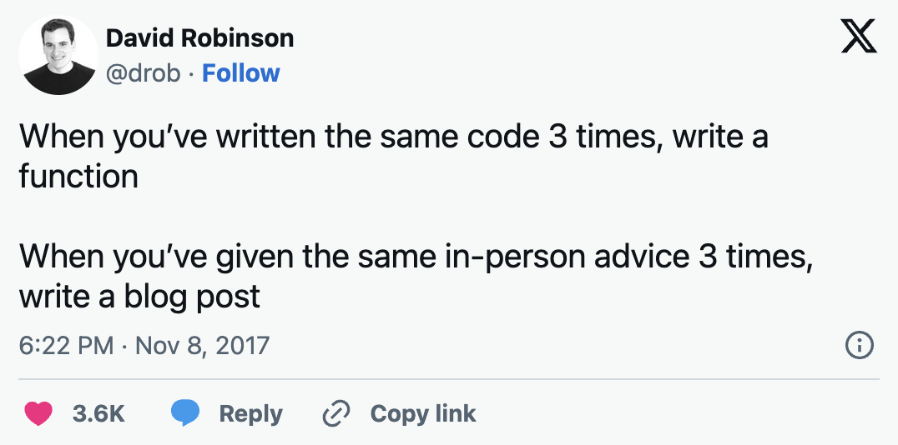
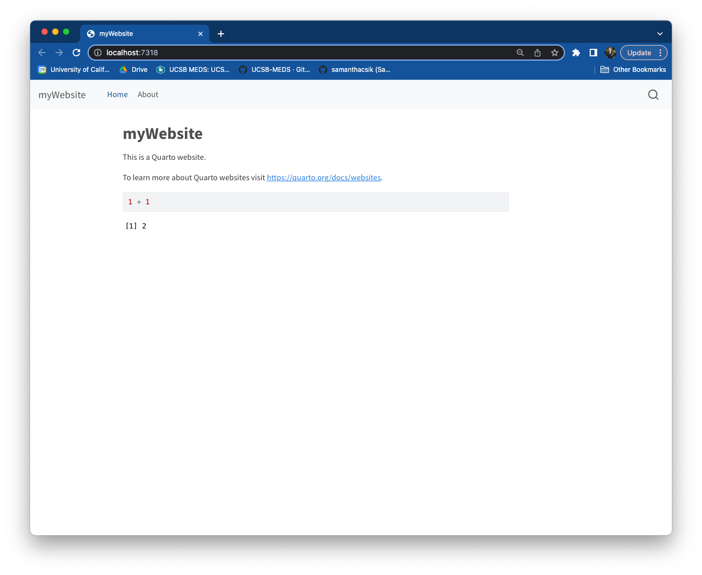
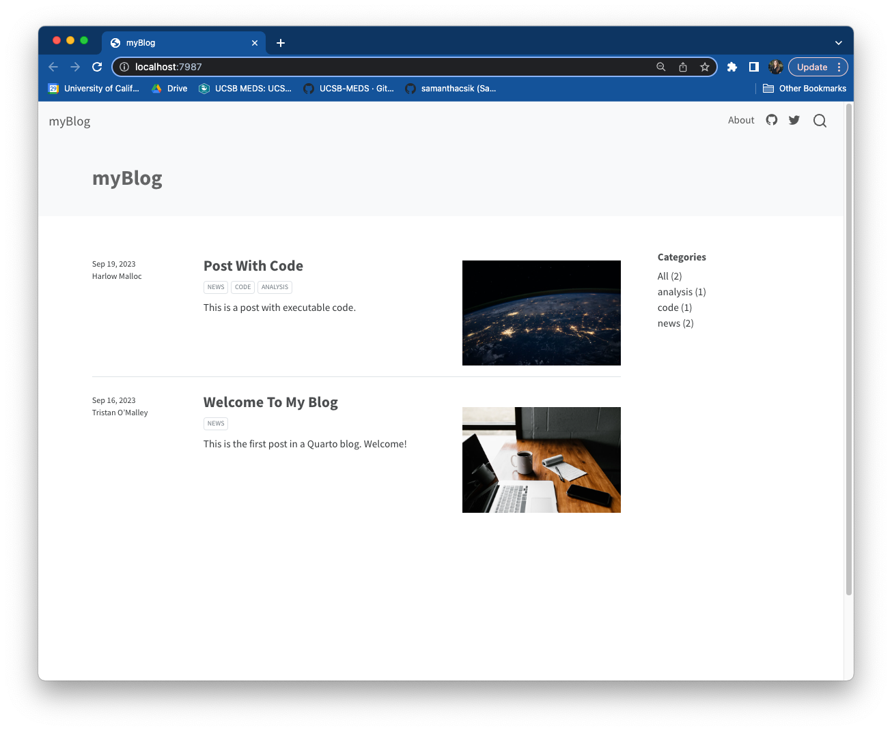
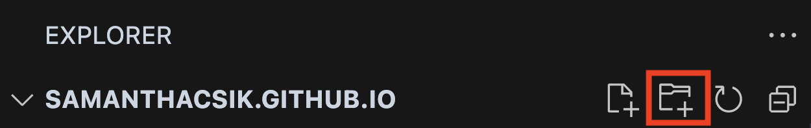
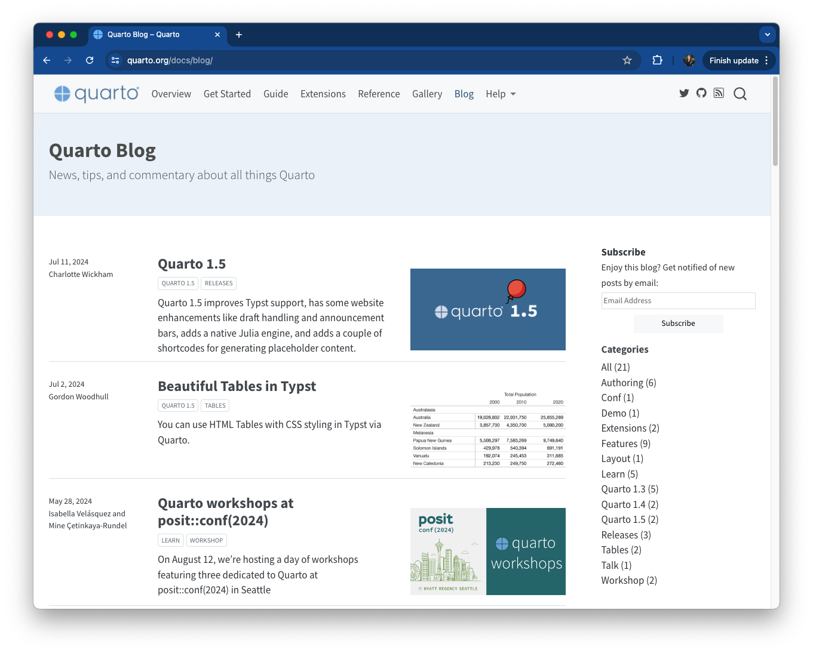
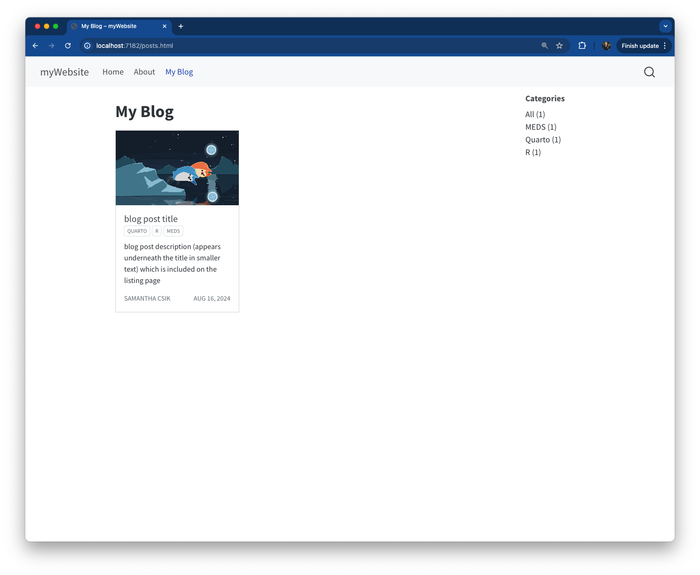
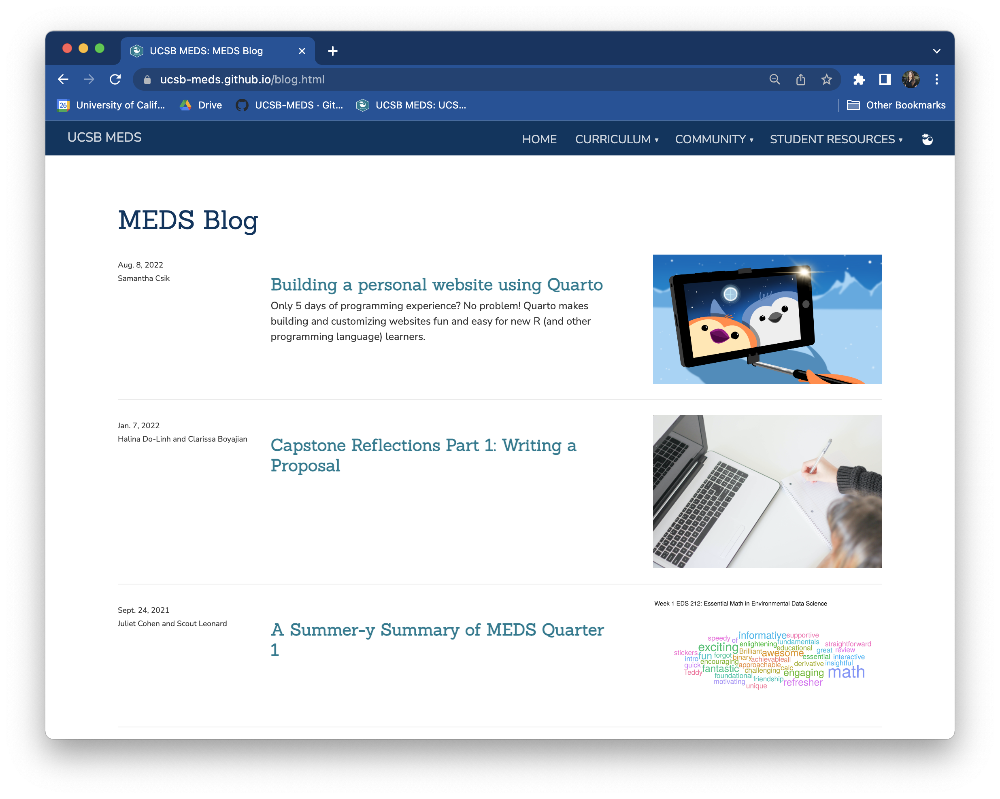
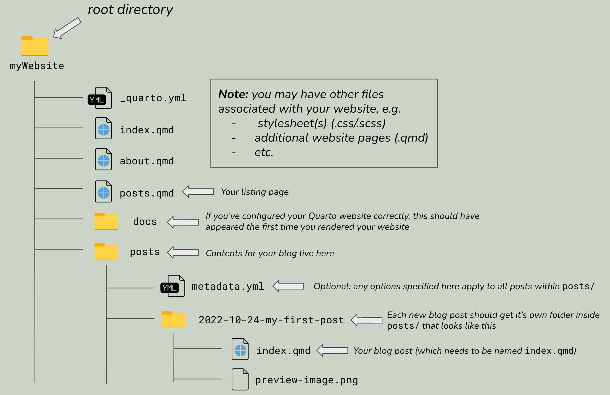
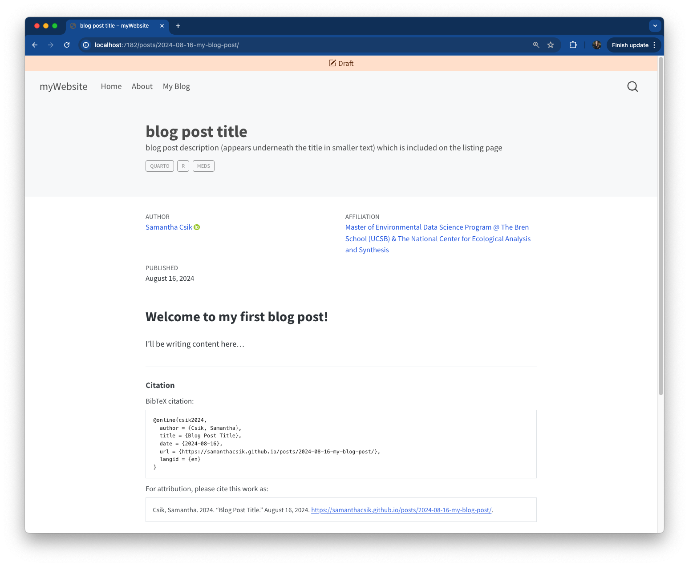
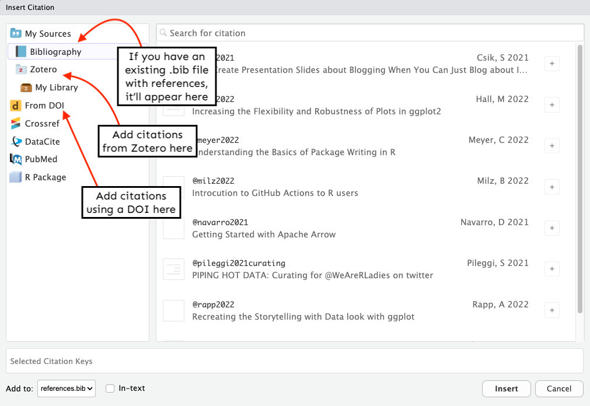

---
format:
  revealjs:
    slide-number: true
    highlight-style: a11y
    chalkboard: true
    theme:
      - ../../meds-slides-styles.scss
editor_options:
  chunk_output_type: console
---

## {#title-slide data-menu-title="Title Slide" background="#053660"}

[Adding a Blog to Your Quarto Website]{.custom-title}

<hr class="hr-teal">

[Wednesday, November 4^th^, 2026]{.custom-subtitle3}

---

## {#why-blog data-menu-title="Why blog?"}

[Why should you blog?]{.slide-title}

<hr>

<br>

Blogging helps you:

. . .

[]{.teal-text} build your online profile and portfolio

. . .

[]{.teal-text} practice writing and communication skills

. . .

[]{.teal-text} network with the data science community

. . .

[]{.teal-text} solidify your own learning and understanding

. . .

[]{.teal-text} combat imposter syndrome

---

## {#drob data-menu-title="DRob tweet"}

[The 3x rule]{.slide-title}

<hr>

```{r}
#| eval: true
#| echo: false
#| out-width: "60%"
#| fig-align: "center"

```

::: {.footer}
Tweet by [David Robinson](https://twitter.com/drob) — author of *Introduction to Empirical Bayes* and former Chief Data Scientist at Heap
:::

---

## {#website-vs-blog data-menu-title="Website vs. Blog"}

[Website vs. Blog]{.slide-title}

<hr>

<br>

:::: {.columns}

::: {.column width="50%"}
::: {.center-text}
**Quarto Website**
:::

```{r}
#| eval: true
#| echo: false
#| out-width: "85%"
#| fig-align: "center"

```

::: {.center-text .body-text-s .gray-text}
Has a dedicated landing/home page
:::
:::

::: {.column width="50%"}
::: {.center-text}
**Quarto Blog**
:::

```{r}
#| eval: true
#| echo: false
#| out-width: "85%"
#| fig-align: "center"

```

::: {.center-text .body-text-s .gray-text}
Features a listing page as the landing page
:::
:::

::::

::: {.center-text}
**The good news:** you can add a blog to your existing Quarto website!
:::

---

## {#tldr data-menu-title="TL;DR"}

[What you need to add a blog]{.slide-title}

<hr>

<br>
<br>

::: {.body-text-m}
[]{.teal-text}  A **folder** to hold your blog posts

<br>

[]{.teal-text}  A **listing page** that displays all blog posts

<br>

[]{.teal-text}  Actual **blog post content**
:::

---

## {#part1 data-menu-title="Part I: Blog Structure" background="#053660"}

[Part I]{.custom-title}

<hr class="hr-teal">

[Setting up your blog's structure]{.custom-subtitle3}

---

## {#step1-posts data-menu-title="Step 1: posts/ folder"}

[Step 1: Create a `posts/` folder]{.slide-title}

<hr>

Create a `posts/` folder in your **root directory**:

:::: {.columns}

::: {.column width="50%"}

<br>

::: {.center-text .blue-box}
[**Positron:**]{.dark-blue-text}

*Hover over your repo name in the Explorer pane > click "New Folder…" > type `posts` > press Enter*
:::

<br>

::: {.center-text .blue-box}
[**RStudio:**]{.dark-blue-text}

*In the Files pane, click "New Folder" > type `posts` > click OK*
:::

:::

::: {.column width="50%"}

<br>

```{r}
#| eval: true
#| echo: false
#| out-width: "90%"
#| fig-align: "center"

```

:::

::::

---

## {#step2-metadata data-menu-title="Step 2: _metadata.yml"}

[Step 2: (Optional) Add `_metadata.yml`]{.slide-title}

<hr>

A `_metadata.yml` file inside `posts/` applies settings to **all posts** automatically

<br>

:::: {.columns}

::: {.column width="55%"}

```{.yaml filename="posts/_metadata.yml"}
# re-render posts only when source changes ----
freeze: auto

# banner style title blocks ----
title-block-banner: true
```

:::

::: {.column width="45%"}

<br>

- `freeze: auto` — only re-renders posts when source files change (great for computationally heavy content)
- `title-block-banner: true` — creates a banner-style title block at the top of each post

:::

::::

---

## {#step3-listing data-menu-title="Step 3: Create listing page"}

[Step 3: Create a listing page]{.slide-title}

<hr>

A **listing page** auto-generates content from your blog posts (titles, dates, categories, preview images)

<br>

Create `posts.qmd` in your **root directory** with minimal content to start:

```{.yaml filename="posts.qmd"}
---
title: "My Blog"
---
```

<br>

::: {.center-text .blue-box}
[**Positron:**]{.dark-blue-text} *Cmd/Ctrl + Shift + P > "Quarto: New Document" > save as `posts.qmd` in root directory*

[**RStudio:**]{.dark-blue-text} *File > New File > Quarto Document… > save as `posts.qmd`*
:::

---

## {#step4-configure data-menu-title="Step 4: Configure listing page"}

[Step 4: Configure your listing page]{.slide-title}

<hr>

Add a `listing` field to your `posts.qmd` YAML:

```{.yaml filename="posts.qmd"}
---
title: "My Blog"
listing:
  contents: posts    # must match your folder name from Step 1
  type: grid         # options: default, grid, or table
  sort: "date desc"  # newest posts first
  categories: true   # enables category filtering
---
```

<br>

```{r}
#| eval: true
#| echo: false
#| out-width: "80%"
#| fig-align: "center"

```

---

## {#listing-types data-menu-title="Listing page types"}

[Three built-in listing page styles]{.slide-title}

<hr>

```{r}
#| eval: true
#| echo: false
#| out-width: "85%"
#| fig-align: "center"

```

::: {.footer}
See [Quarto docs](https://quarto.org/docs/websites/website-listings.html#listing-types) for a full preview of each listing type
:::

---

## {#step5-navbar data-menu-title="Step 5: Add to navbar"}

[Step 5: Add your listing page to the navbar]{.slide-title}

<hr>

Update `_quarto.yml` to include `posts.qmd` just like any other page:

```{.yaml filename="_quarto.yml"}
website:
  navbar:
    title: myWebsiteTitle
    right:
      - href: index.qmd
        text: Home
      - about.qmd
      - posts.qmd   # add your listing page here
```

---

## {#step6-preview data-menu-title="Step 6: Preview"}

[Step 6: Preview your site]{.slide-title}

<hr>

Run `quarto preview` in your terminal to see your changes:

```{.bash}
quarto preview
```

<br>

```{r}
#| eval: true
#| echo: false
#| out-width: "85%"
#| fig-align: "center"

```

::: {.footer}
Your listing page will be empty until you add your first blog post — that's expected!
:::

---

## {#part2 data-menu-title="Part II: Writing Posts" background="#053660"}

[Part II]{.custom-title}

<hr class="hr-teal">

[Creating your first blog post]{.custom-subtitle3}

---

## {#post-step1 data-menu-title="Post Step 1: Subdirectory"}

[Step 1: Create a subdirectory inside `posts/`]{.slide-title}

<hr>

Each post gets its **own folder** inside `posts/` using this naming convention:

::: {.center-text .body-text-m}
`YYYY-MM-DD-short-post-description`
:::

<br>

```{r}
#| eval: true
#| echo: false
#| out-width: "55%"
#| fig-align: "center"

```

::: {.footer}
The folder name becomes the **URL slug** for your post — keep it short and descriptive!
:::

---

## {#post-step2 data-menu-title="Post Step 2: index.qmd"}

[Step 2: Create `index.qmd` inside your subdirectory]{.slide-title}

<hr>

<br>

Name your post file `index.qmd` — this keeps your URLs clean:

<br>

:::: {.columns}

::: {.column width="50%"}
::: {.center-text}
**With `index.qmd`** ✓
:::
```
yoursite.com/posts/
  2022-10-24-my-post/
```
:::

::: {.column width="50%"}
::: {.center-text}
**With `my-post.qmd`** ✗
:::
```
yoursite.com/posts/
  2022-10-24-my-post/
  my-post.html
```
:::

::::

<br>

::: {.center-text}
The `index.qmd` approach creates **shorter, cleaner URLs** that are easier to remember and share
:::

---

## {#post-step3 data-menu-title="Post Step 3: Configure YAML"}

[Step 3: Configure your blog post YAML]{.slide-title}

<hr>

```{.yaml filename="posts/2022-10-24-my-post/index.qmd"}
---
title: "My first blog post"
description: "A short description that appears on the listing page"
author:
  - name: Your Name
    url: https://yoursite.com/
    affiliation: Master of Environmental Data Science Program @ The Bren School
    affiliation-url: https://ucsb-meds.github.io/
date: 10-24-2022
categories: [Quarto, R, MEDS]
citation:
  url: https://yoursite.com/posts/2022-10-24-my-post/
image: preview-image.png
draft: false
---

Here is where your blog post content begins...
```

---

## {#yaml-fields data-menu-title="YAML fields explained"}

[Key YAML fields]{.slide-title}

<hr>

| Field | Purpose |
|-------|---------|
| `title` & `description` | Both appear on your listing page |
| `author` | Can include `name`, `url`, `orcid`, `affiliation` |
| `date` | Post date (format: MM-DD-YYYY) |
| `categories` | Self-defined tags — enables filtering on listing page |
| `citation` | Auto-generates a BibTeX citation at the bottom of your post |
| `image` | Preview image shown on listing page — file must live in the same folder |
| `draft: true` | Hides from listing page while you work — set to `false` to publish |

: {.hover .bordered tbl-colwidths="[25,75]"}

---

## {#post-step4 data-menu-title="Post Step 4: _metadata.yml"}

[Step 4: Simplify with `_metadata.yml`]{.slide-title}

<hr>

Move repeated `author` info to `_metadata.yml` so you only write it once:

:::: {.columns}

::: {.column width="50%"}

```{.yaml filename="posts/_metadata.yml"}
freeze: auto
title-block-banner: true

# author info applied to all posts ----
author:
  - name: Your Name
    url: https://yoursite.com/
    affiliation: MEDS @ The Bren School
    affiliation-url: https://ucsb-meds.github.io/
```

:::

::: {.column width="50%"}

```{.yaml filename="posts/2022-10-24-my-post/index.qmd"}
---
title: "My first blog post"
description: "A short description"
date: 10-24-2022
categories: [Quarto, R, MEDS]
citation:
  url: https://yoursite.com/posts/
       2022-10-24-my-post/
image: preview-image.png
draft: false
---
```

:::

::::

::: {.footer}
Author info is inherited from `_metadata.yml` — override it in a post's YAML when co-authoring
:::

---

## {#blog-added data-menu-title="Blog added"}

[Your first post on the listing page]{.slide-title}

<hr>

```{r}
#| eval: true
#| echo: false
#| out-width: "90%"
#| fig-align: "center"

```

---

## {#advanced data-menu-title="Advanced Features" background="#053660"}

[Advanced Features]{.custom-title}

<hr class="hr-teal">

[Footnotes, citations, and more]{.custom-subtitle3}

---

## {#footnotes data-menu-title="Footnotes"}

[Adding footnotes]{.slide-title}

<hr>

<br>

**Method 1 — Referenced:**
```{.markdown}
I am going to insert a footnote here[^1].

[^1]: Here is the associated footnote text.
```

<br>

**Method 2 — Inline:**
```{.markdown}
I am going to insert an inline footnote here^[Here is my inline footnote].
```

<br>

All footnotes are automatically collected in a **"Footnotes" section** at the bottom of your post.

---

## {#citations1 data-menu-title="Citations 1"}

[Adding citations]{.slide-title}

<hr>

**Step 1:** Create a `references.bib` file inside your post folder

**Step 2:** Add `bibliography` to your post YAML:
```{.yaml}
bibliography: references.bib
```

**Step 3:** Add references in BibTeX format to your `.bib` file:
```{.bibtex}
@online{csik2021,
  author = {Samantha Csik},
  title  = {Why Create Presentation Slides about Blogging When You Can Just Blog about It?},
  date   = {2021-09-24},
  url    = {https://samanthacsik.github.io/posts/2021-09-21-distill-blogs/},
  langid = {en}
}
```

**Step 4:** Cite in your text using `[@key]`:
```{.markdown}
This was explored in previous work [@csik2021].
```

---

## {#citations2 data-menu-title="Citations 2"}

[The easier way: Visual Editor citations]{.slide-title}

<hr>

```{r}
#| eval: true
#| echo: false
#| out-width: "90%"
#| fig-align: "center"

```

::: {.footer}
In Positron or RStudio: open the Visual editor > Insert > Citation — Quarto automatically updates your `.bib` file. No manual BibTeX formatting required!
:::

---

## {#multiple-blogs data-menu-title="Multiple blogs"}

[You're not limited to one blog]{.slide-title}

<hr>

<br>

Repeat **Part I** (Steps 1–6) to add additional listing pages to your site:

<br>

::: {.body-text-m}
[]{.teal-text} `posts.qmd` — your main blog

[]{.teal-text} `talks_workshops.qmd` — talks & workshops

[]{.teal-text} `courses.qmd` — courses taught

[]{.teal-text} `projects.qmd` — data projects & capstones
:::

<br>

::: {.footer}
See [Sam Shanny-Csik's GitHub repo](https://github.com/samanthacsik/samanthacsik.github.io) for a real-world example of this structure
:::

---

## {#resources data-menu-title="Resources"}

[Additional resources]{.slide-title}

<hr>

<br>

[]{.teal-text} **[The ultimate guide to starting a Quarto blog](https://albert-rapp.de/posts/13_quarto_blog_writing_guide/13_quarto_blog_writing_guide.html)** by Albert Rapp — deep dive into customization options

<br>

[]{.teal-text} **[Creating a blog with Quarto in 10 steps](https://beamilz.com/posts/2022-06-05-creating-a-blog-with-quarto/en/)** by Beatriz Milz — includes adding a comments section

<br>

[]{.teal-text} **[Quarto listing page documentation](https://quarto.org/docs/websites/website-listings.html)** — full reference for listing page options

<br>

[]{.teal-text} **[Quarto article layout documentation](https://quarto.org/docs/authoring/article-layout.html)** — customize your post's page layout
